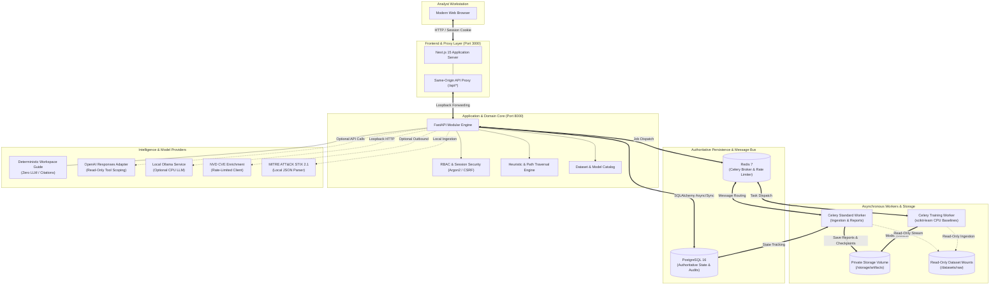
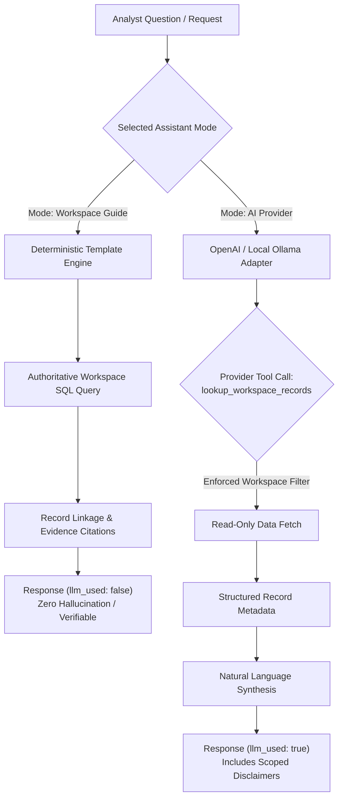

# AEGIS — Autonomous Cyber-Immune System

[](https://github.com/saikriz898/AEIGS-Autonomus-Cyber-Imune-System/actions/workflows/ci.yml)
[](https://github.com/saikriz898/AEIGS-Autonomus-Cyber-Imune-System/actions/workflows/release.yml)
[](#security-boundaries-and-responsible-use)
[](https://nextjs.org/)
[](https://fastapi.tiangolo.com/)
[](https://www.postgresql.org/)
[](https://docs.docker.com/compose/)

> **Repository:** [saikriz898/AEIGS-Autonomus-Cyber-Imune-System](https://github.com/saikriz898/AEIGS-Autonomus-Cyber-Imune-System)  
> **Workspace Name:** `AEIGS` | **Application Name:** `AEGIS` (Autonomous Enterprise Guardian & Immune System)

---

## Executive Summary & Vision

**AEGIS** is a defensive, human-in-the-loop autonomous cybersecurity platform engineered to model, analyze, and neutralize enterprise attack vectors before exploitation occurs. Inspired by biological immune systems, AEGIS continuously ingests authorized infrastructure records, constructs an interactive **Digital Twin** graph, traces hypothetical attack paths, simulates threat scenarios deterministically, ranks mitigation playbooks, and records verified human defensive approvals through the **Guardian Gate**.

AEGIS contains **two distinct, self-contained implementations** in this single repository:

1. **`full-product/` (Enterprise Modular Monolith):** A production-grade multi-tenant workspace built with **Next.js 15, FastAPI, PostgreSQL 16, Redis, and Celery background workers**. It provides persistent storage, role-based access control (RBAC), offline scikit-learn machine learning pipelines, dataset profiling, threat contextualization (CVE/NVD & MITRE ATT&CK STIX), and dual-mode AI assistance (deterministic Workspace Guide and LLM provider integration).
2. **`prototype/` (Client-Side Interactive Demonstrator):** A lightweight, zero-dependency browser application built with **React 18, Vite 6, and TypeScript**. It runs entirely in client-side memory and browser `localStorage`, pre-seeded with 12 assets, 12 directed relationships, 10 vulnerability findings, and 3 simulation scenarios. It requires no Docker, database, or network credentials.

```
       ┌────────────────────────────────────────────────────────────────────────┐
       │                      AEGIS DEFENSIVE WORKSPACE                         │
       └───────────────────────────────────┬────────────────────────────────────┘
                                           │
  ┌───────────────────────┬────────────────┴──────────────────┬───────────────────────┐
  ▼                       ▼                                   ▼                       ▼
Scope & Asset      Risk Intelligence                   Digital Twin &          Defense Advisor &
 Inventory         & Heuristic Engine                 Simulation Engine          Guardian Gate
┌─────────────┐    ┌───────────────────────────┐      ┌─────────────────┐      ┌─────────────────┐
│ Authorized  │───▶│ - Exposure & Criticality  │─────▶│ - Graph Topology│─────▶│ - Ranked Action │
│ Scope, CIDR │    │ - CVSS Base Translation   │      │ - Path Traversal│      │ - Trade-off Anal.│
│ & Metadata  │    │ - Asset & Workspace Score │      │ - Blast Radius  │      │ - Human Sign-off│
└─────────────┘    └───────────────────────────┘      └─────────────────┘      └─────────────────┘
                                           │
                                           ▼
                       ┌───────────────────────────────────────┐
                       │   AUDIT TRAILS, REPORTS & TELEMETRY   │
                       └───────────────────────────────────────┘
```

---

## Table of Contents

- [Architectural Comparison: Full Product vs. Prototype](#architectural-comparison-full-product-vs-prototype)
- [System Architecture](#system-architecture)
- [Core Features & Modules](#core-features--modules)
- [Mathematical Scoring & Simulation Heuristics](#mathematical-scoring--simulation-heuristics)
- [Quickstart: Full Product (Docker Compose)](#quickstart-full-product-docker-compose)
- [Quickstart: Browser Prototype (Node.js & Vite)](#quickstart-browser-prototype-nodejs--vite)
- [Repository Map & Code Navigation](#repository-map--code-navigation)
- [Configuration & Environment Reference](#configuration--environment-reference)
- [Machine Learning & Offline Dataset Operations](#machine-learning--offline-dataset-operations)
- [AI Assistant & Deterministic Workspace Guide](#ai-assistant--deterministic-workspace-guide)
- [Threat Intelligence & Contextual Adapters](#threat-intelligence--contextual-adapters)
- [Testing, Verification & Quality Assurance](#testing-verification--quality-assurance)
- [CI/CD Pipelines & Container Delivery](#cicd-pipelines--container-delivery)
- [Backup, Disaster Recovery & Operations](#backup-disaster-recovery--operations)
- [Security Boundaries and Responsible Use](#security-boundaries-and-responsible-use)
- [Contributing & Vulnerability Reporting](#contributing--vulnerability-reporting)

---

## Architectural Comparison: Full Product vs. Prototype

| Capability | `full-product/` (Enterprise System) | `prototype/` (Demonstrator) |
| :--- | :--- | :--- |
| **Primary Goal** | Multi-user operational defensive platform | Rapid exploration of UX & scoring math |
| **Frontend Stack** | Next.js 15 (App Router), React 19, TypeScript, Tailwind | React 18, Vite 6, TypeScript, Lucide |
| **Backend API** | FastAPI, Pydantic v2, SQLAlchemy 2.0 (async/sync) | None (In-browser pure TypeScript engine) |
| **Persistence** | PostgreSQL 16 with Alembic migrations | Browser `localStorage` (`aegis.workspace.v1`) |
| **Task Queue** | Celery distributed workers with Redis broker | Synchronous client-side event loops |
| **Authentication** | Argon2id hashing, HttpOnly session cookies, CSRF guards | Local simulated analyst display name |
| **Authorization** | Strict RBAC: Owner, Admin, Analyst, Viewer | Flat single-user sandbox |
| **AI Integration** | Deterministic Guide (no LLM) + OpenAI/Local CPU LLM | Architecture diagrams & static agent roles |
| **Data Pipelines** | Chunked CSV/Parquet ingestion, scikit-learn models | Preloaded static JSON seed records |
| **Default Host** | `http://localhost:3000` (API on `:8000`) | `http://127.0.0.1:5173` |

---

## System Architecture

The full AEGIS architecture is built as a hardened, containerized modular monolith. Client traffic reaches the Next.js frontend, which proxies authenticated backend requests to the FastAPI core. Database and queue networks remain strictly isolated from direct host access.



### Security & Isolation Boundaries

1. **Network Binding:** Containers bind strictly to `127.0.0.1` loopback on host ports `3000` (Frontend) and `8000` (API). PostgreSQL and Redis have no exposed host ports.
2. **Least Privilege Execution:** Containers run as an unprivileged system user (`uid: 10001, gid: 10001`).
3. **Dataset Immutability:** Raw archive folders are mounted `ro` (read-only); training processes cannot alter source forensic data.
4. **Tenant Enclosure:** Every database query enforces explicit `workspace_id` scoping to prevent lateral cross-tenant access.

---

## Core Features & Modules

### 1. Scope & Workspace Governance
- **Boundary Control:** Define authorized CIDR blocks, hostnames, and domain boundaries.
- **Multi-Tenancy:** Create private workspaces with distinct asset sets, finding registries, and simulation states.
- **RBAC Matrix:**
  - **Owner:** Full system administrative control, user provisioning, model activation, and workspace deletion.
  - **Admin:** Member management, dataset permission verification, and policy adjustments.
  - **Analyst:** Asset creation, finding triage, simulation execution, and recommendation review.
  - **Viewer:** Read-only access to topologies, reports, and audit logs.

### 2. Asset Inventory & Discovery
- **Metadata Management:** Track asset name, FQDN/IP, critical business role, operating system, network tier, and environment.
- **Exposure Classifications:** `Internet-Facing`, `Internal-Only`, and `Isolated/Air-Gapped`.
- **Zero-Probe Guarantee:** Registering an asset stores metadata in PostgreSQL without sending discovery packets, port scans, or SYN probes.

### 3. Risk Intelligence & Heuristics
- **Normalized Severity:** Maps raw vulnerability base scores to granular enterprise risk levels.
- **Explainable Factors:** Provides itemized breakdowns showing exactly how exposure and asset criticality elevate finding scores.
- **Dynamic Aggregation:** Updates asset-level and workspace-level risk in real-time as findings are resolved or re-evaluated.

### 4. Digital Twin & Attack Graph Topology
- **Interactive Visualizer:** Custom HTML5 Canvas / SVG topology visualizer rendering nodes, clusters, and directional ingress/egress edges.
- **Relationship Taxonomies:**
  - `Observed`: Verified network adjacency or communication channel.
  - `Inferred`: Logical dependency (e.g., authentication trust or database connection).
  - `Hypothetical`: Potential pivot route modeled for red-team analysis.
- **Depth-First Search (DFS) Traversal:** Bounded path discovery algorithm detecting lateral movement paths up to 7 hops deep without cyclic loops.

### 5. Attack Simulation Engine
- **Deterministic Scenarios:** Evaluates pre-configured or analyst-selected threat paths (e.g., *External Supply Chain Pivot to Core Database*).
- **Blast Radius Analysis:** Computes affected asset lists, compromised data assets, and cumulative risk exposure along the route.
- **Repeatable Outcomes:** Identical graph states generate identical impact reports, producing reliable telemetry for compliance review.

### 6. Defense Advisor & Guardian Gate
- **Prioritized Recommendations:** Algorithmic ranking balancing risk reduction against operational downtime and administrative overhead.
- **Trade-off Scoring:** Prevents disruptive countermeasures from taking precedence over low-friction, high-impact remediations.
- **Guardian Gate Sign-Off:** Formal human-in-the-loop gate requiring analyst identity, rationale, and timestamp before marking an advisory as approved or rejected.
- **No Direct Modification:** Approving an advisory creates an auditable record; it **never** executes automated firewall, cloud, or endpoint script changes.

### 7. Audit Trails & Governance Reporting
- **Immutable Log:** Every sign-in, asset edit, simulation execution, and Guardian Gate decision is appended to an immutable audit table.
- **Executive Reporting:** Generates comprehensive, timestamped Markdown/JSON reports capturing full workspace posture for audit compliance.

---

## Mathematical Scoring & Simulation Heuristics

AEGIS avoids opaque "black box" security scores in favor of deterministic, mathematically verifiable heuristics.

### 1. Finding Risk Formulation
For any active vulnerability finding on an asset:

$$\text{Base Contribution} = \text{round}(\text{CVSS Base Score} \times 7, 1)$$

$$\text{Finding Risk Score} = \min\left(100, \text{round}\left(\text{Base Contribution} + \text{Exposure Bonus} + \text{Criticality Bonus}\right)\right)$$

| Exposure Tier | Bonus Points | Criticality Tier | Bonus Points |
| :--- | :---: | :--- | :---: |
| **Internet-Facing** | $+15$ | **Critical** | $+15$ |
| **Internal** | $+5$ | **High** | $+10$ |
| **Isolated** | $+0$ | **Medium** | $+5$ |
| — | — | **Low** | $+0$ |

- **Resolved Finding Rule:** When a finding's status is toggled to `Resolved`, its contribution drops immediately to $0$.
- **Severity Classification Bands:**
  - **Critical:** $\ge 75$
  - **High:** $\ge 50$
  - **Medium:** $\ge 25$
  - **Low:** $< 25$

### 2. Asset Risk Score
An asset's risk is determined by its highest individual active finding score:

$$\text{Asset Risk} = \max\left(\{0\} \cup \{\text{Finding Risk}_k \mid k \in \text{Active Findings for Asset}\}\right)$$

### 3. Workspace Aggregate Risk Score
The global posture score is the arithmetic mean of all asset risks within the workspace:

$$\text{Workspace Risk} = \text{round}\left(\frac{1}{N} \sum_{i=1}^{N} \text{Asset Risk}_i\right)$$

*(A workspace score of 0 indicates absence of recorded findings, not certified absence of risk.)*

### 4. Defensive Recommendation Ranking Heuristic
Recommendations in Defense Advisor are ranked by Priority Index ($P$):

$$P = (\Delta R \times 2) - (D \times 5) - (E \times 3)$$

- $\Delta R$: Estimated Risk Reduction ($0 - 100$)
- $D$: Operational Disruption Factor ($1 - 5$)
- $E$: Implementation Effort Factor ($1 - 5$)
- Tie-breaking: Stable alphanumeric ordering by recommendation identifier.

---

## Quickstart: Full Product (Docker Compose)

### Prerequisites
- [Docker Desktop](https://www.docker.com/) with Linux Container mode enabled and Docker Compose v2.
- Python 3.10+ (used solely to execute the initial setup configuration helper).
- 4GB+ RAM allocated to Docker.

### 1. Clone & Configure
```powershell
# In PowerShell (Windows)
git clone https://github.com/saikriz898/AEIGS-Autonomus-Cyber-Imune-System.git
Set-Location AEIGS-Autonomus-Cyber-Imune-System\full-product

# Run the secure configuration helper (generates random database & setup secrets in .env)
py scripts/configure.py
```
*(On Linux/macOS, use `cd full-product && python3 scripts/configure.py`)*

### 2. Build & Launch Containers
```powershell
docker compose up --build -d --wait
docker compose ps
```

The stack initializes the following services:
- **Web Interface:** `http://localhost:3000`
- **FastAPI Documentation:** `http://localhost:8000/api/docs`
- **Readiness Probe:** `http://localhost:8000/api/ready`

### 3. Bootstrap First Owner Account
Once the API reports ready, initialize the primary administrative account:

```powershell
docker compose exec api python -m app.bootstrap --email admin@example.com --name "Lead SecOps" --workspace "Primary Enterprise Defense"
```
*Enter a secure password (minimum 12 characters) when prompted.*

Alternatively, navigate to `http://localhost:3000/register` in your browser and enter the private `SETUP_TOKEN` printed in your `.env` file.

---

## Quickstart: Browser Prototype (Node.js & Vite)

The prototype is a zero-configuration, browser-only demonstration suitable for offline workshops, air-gapped laptops, or rapid UI reviews.

### Prerequisites
- Node.js 20.18+ or Node.js 22 LTS.
- npm 10+.

### 1. Install & Launch
```powershell
Set-Location D:\AEIGS\prototype
npm ci
npm run dev
```

### 2. Access the Application
Open **`http://127.0.0.1:5173`** in Google Chrome, Edge, or Firefox.
- **Persistence:** Edits and simulations are saved in your browser's `localStorage` (`aegis.workspace.v1`).
- **Reset:** Use the in-app "Reset to Default Seed" button or clear browser site data to restore the 12 default synthetic assets.

### 3. Production Build & Preview
```powershell
npm run build
npm run preview
```
Access the optimized static build at `http://127.0.0.1:4173`.

---

## Repository Map & Code Navigation

```text
AEIGS/
├── .github/                                # Automation and release infrastructure
│   ├── ISSUE_TEMPLATE/                     # Standardized bug & feature templates
│   ├── workflows/
│   │   ├── ci.yml                          # Tests, typecheck, lint, container validation
│   │   └── release.yml                     # GHCR container delivery on version tags
│   ├── dependabot.yml                      # Automated dependency update cadence
│   └── pull_request_template.md            # Verification & change checklist
├── .gitignore                              # Git exclusions (caches, logs, datasets, credentials)
├── CONTRIBUTING.md                         # Contribution workflows & coding standards
├── README.md                               # Global architectural guide (this document)
├── SECURITY.md                             # Responsible disclosure & vulnerability policy
│
├── prototype/                              # STANDALONE BROWSER DEMONSTRATOR
│   ├── public/aegis.svg                    # Vector brand mark
│   ├── src/
│   │   ├── components/                     # Topology canvas, UI primitives, modals
│   │   ├── domain/                         # Heuristic engine, seed assets, storage schema
│   │   │   ├── engine.ts                   # Risk scoring, DFS path finder, simulation
│   │   │   ├── seed.ts                     # Authored 12-asset synthetic enterprise graph
│   │   │   ├── storage.ts                  # LocalStorage schema migration & validation
│   │   │   └── types.ts                    # Core TypeScript domain contracts
│   │   ├── pages/                          # Command Center, Inventory, Digital Twin, etc.
│   │   ├── state/                          # WorkspaceContext reactive provider
│   │   ├── App.tsx                         # Root navigation shell
│   │   └── main.tsx                        # DOM bootstrap
│   ├── tests/                              # Playwright & Vitest test suites
│   ├── package.json                        # Dependencies (React 18, Vite 6, Vitest)
│   └── README.md                           # Prototype deep-dive guide
│
└── full-product/                           # PRODUCTION ENTERPRISE SYSTEM
    ├── backend/                            # FastAPI Application Core
    │   ├── alembic/                        # Database migration revisions
    │   ├── app/
    │   │   ├── ai_providers.py             # OpenAI Responses & Local AI adapters
    │   │   ├── assistant.py                # Scoped conversation management
    │   │   ├── bootstrap.py                # CLI owner setup utility
    │   │   ├── catalog.py                  # Dataset catalog & duplicate resolution
    │   │   ├── config.py                   # Pydantic environment settings
    │   │   ├── datasets.py                 # File profiling & quality validation
    │   │   ├── db.py                       # SQLAlchemy async/sync engine sessionmaker
    │   │   ├── domain.py                   # Server-side risk & path engine
    │   │   ├── jobs.py                     # Celery task definitions (ingestion, training)
    │   │   ├── main.py                     # FastAPI application endpoints
    │   │   ├── ml.py                       # scikit-learn offline pipeline trainers
    │   │   ├── models.py                   # Declarative PostgreSQL relational models
    │   │   ├── schemas.py                  # Pydantic v2 API request/response schemas
    │   │   ├── security.py                 # Argon2 hashing, session tokens, CSRF tokens
    │   │   ├── storage.py                  # Private artifact volume managers
    │   │   └── threat_adapters.py          # NVD rate-limiter & ATT&CK STIX 2.1 loader
    │   ├── tests/                          # Backend Pytest test suites
    │   ├── requirements.txt                # Direct Python runtime dependencies
    │   ├── requirements.lock               # Pinned reproducible dependency hashes
    │   └── ruff.toml                       # Python lint & format rules
    ├── frontend/                           # Next.js 15 Application Core
    │   ├── app/                            # App Router pages and `/api/[...path]` proxy
    │   ├── components/                     # Workspace, GraphCanvas, AssistantConsole, UI
    │   ├── lib/api.ts                      # Fetch wrapper with CSRF injection
    │   ├── package.json                    # Dependencies (Next.js 15, React 19)
    │   └── playwright.config.ts            # E2E browser test configuration
    ├── docker/                             # Hardened unprivileged Dockerfiles
    │   ├── backend.Dockerfile              # Python 3.12-slim multistage image
    │   └── frontend.Dockerfile             # Node 22-alpine production standalone image
    ├── compose.yaml                        # Local Docker Compose topology
    ├── .env.example                        # Safe template for local deployments
    ├── data/
    │   ├── dataset-manifest.json           # SHA-256 catalog of inspected research datasets
    │   └── raw/                            # Target directory for authorized CSVs (Git-ignored)
    ├── docs/                               # Engineering documentation
    │   ├── AI_AND_INTEGRATIONS.md          # LLM tool-calling & threat context specs
    │   ├── ARCHITECTURE.md                 # Service architecture & boundaries
    │   ├── DATASETS.md                     # Dataset profiling, licensing, & ML pipeline
    │   ├── ENVIRONMENT.md                  # Comprehensive variable dictionary
    │   ├── GAPS.md                         # Architecture gap analysis & roadmap
    │   ├── GITHUB.md                       # CI/CD & GHCR image publishing guide
    │   ├── OPERATIONS.md                   # Backup, restore & runbook instructions
    │   └── VERIFICATION.md                 # Executed verification records & test logs
    └── scripts/                            # Operations and configuration helpers
        ├── configure.py                    # Random secret generation script
        ├── inspect_datasets.py             # CSV SHA-256 and column profiler
        └── setup_local_ai.py               # Local CPU model downloader & launcher
```

---

## Configuration & Environment Reference

All deployment configuration is managed via `full-product/.env`. A sanitized template is provided at `full-product/.env.example`.

| Variable | Default Value | Description & Purpose |
| :--- | :--- | :--- |
| `AEGIS_COMPOSE_PROJECT` | `aegis-full-product` | Docker Compose project prefix. **Keep stable** to preserve volume bindings. |
| `POSTGRES_USER` | `aegis` | Database user account name. |
| `POSTGRES_PASSWORD` | *(Auto-generated)* | 32-character random database credential. |
| `POSTGRES_DB` | `aegis` | Authoritative PostgreSQL database name. |
| `SETUP_TOKEN` | *(Auto-generated)* | Private 64-character token for first-owner web registration. |
| `FRONTEND_PORT` | `3000` | Host port mapped to the Next.js frontend. |
| `API_PORT` | `8000` | Host port mapped to the FastAPI backend. |
| `FRONTEND_ORIGIN` | `http://localhost:3000` | Whitelisted browser origin for CORS and CSRF validation. |
| `COOKIE_SECURE` | `false` | Set to `true` when deploying behind a TLS/HTTPS reverse proxy. |
| `ALLOW_SELF_REGISTRATION` | `true` | Allows new users to create accounts and private workspaces. |
| `DATASET_ROOTS` | `/datasets/unsw,...` | Comma-delimited allowlist of container paths permitted for data ingestion. |
| `AI_PROVIDER` | `none` | Active assistant provider: `none`, `openai`, or `local`. |
| `OPENAI_API_KEY` | *(Empty)* | Secret API key if `AI_PROVIDER=openai`. |
| `OPENAI_MODEL` | `gpt-4o-mini` | Model identifier used for OpenAI tool calling. |
| `LOCAL_AI_BASE_URL` | `http://local-model:11434/v1` | URL for local OpenAI-compatible inference endpoint. |
| `INTEGRATION_NETWORK_ENABLED`| `false` | Master switch controlling outbound threat intelligence calls. |
| `NVD_API_KEY` | *(Empty)* | Optional key for NIST NVD API rate-limit exemption. |
| `COMPOSE_PROFILES` | *(Empty)* | Comma-separated profiles: `training` (CPU worker), `local-ai` (Ollama). |

---

## Machine Learning & Offline Dataset Operations

AEGIS provides an offline machine learning subsystem designed to train baseline classification models on network and endpoint telemetry without sending sensitive security data to cloud providers.

### Inspected Dataset Inventory
The repository has been mapped against four prominent forensic datasets. Their cryptographic profiles are preserved in `full-product/data/dataset-manifest.json`:

| Dataset Family | SHA-256 Checksum (Prefix) | Rows | Cols | Identified Target Labels | Data Quality Notes |
| :--- | :--- | ---: | ---: | :--- | :--- |
| **UNSW-NB15 (Extract 2)** | `41f7d54025...` | 340,693 | 40 | `attack` | 5 attack classes; zero benign samples; 198,253 duplicate rows. |
| **IoT Intrusion** | `8ab09520cb...` | 1,048,575 | 47 | `label` | Task-specific IoT telemetry; 65,556 duplicate rows. |
| **ToN_IoT Network** | `ca033327cb...` | 211,043 | 44 | `label`, `type` | Dual candidate targets; requires explicit analyst target choice. |
| **Phishing Features** | `c2a2977464...` | 160,064 | 13 | `label` | High class imbalance (159,244 vs 820); raw `url` excluded from features. |

```
                       DATASET GOVERNANCE LIFECYCLE
                       
  [ Raw CSV File ] ──▶ [ Read-Only Mount ] ──▶ [ SHA-256 Integrity Check ]
                                                        │
                                                        ▼
  [ Model Activation ] ◀── [ Train Baseline ] ◀── [ Provenance & Mapping ]
   - Explicit Rollback      - scikit-learn RFC     - Task: Network/IoT/Phishing
   - Inactive by Default    - Train/Test Split     - Permission: Non-Commercial
   - Precision / Recall     - Leakage Filter       - Direct Identifiers Dropped
```

### Governance Rules for Training
1. **Explicit Permission Review:** Training remains blocked by default until an Owner or Admin records verified source attribution, citation, and licensing terms (`reviewed_noncommercial` or `reviewed_permitted`).
2. **Task Isolation:** Models cannot be trained across mixed domains. Network intrusion, IoT anomaly detection, and phishing feature sets are strictly segregated.
3. **Target Leakage Prevention:** Raw identifiers, system timestamps, and URLs are automatically excluded from the feature matrix.
4. **Model Activation Gate:** Newly trained models are stored in `/storage/artifacts/models/` in an **inactive** state. An administrator must explicitly review evaluation metrics (Precision, Recall, F1, Macro-F1, ROC-AUC) and activate the model.

---

## AI Assistant & Deterministic Workspace Guide

AEGIS provides two mutually exclusive operational modes for natural-language analysis:



### Mode 1: Deterministic Workspace Guide (No LLM)
- **Zero Hallucinations:** Operates without any neural language model or external API keys.
- **Rule-Based Synthesis:** Analyzes current workspace records directly using deterministic Python logic.
- **Verifiable Citations:** Every response explicitly cites exact asset identifiers, finding IDs, and calculation steps.
- **Audit Tag:** Saved in conversation history with metadata `provider=workspace_guide`, `mode=deterministic`, and `llm_used=false`.

### Mode 2: AI Provider (OpenAI or Local CPU LLM)
- **Bounded Tool Calling:** The model is equipped with a single read-only tool: `lookup_workspace_records`.
- **Backend-Enforced Authorization:** Tool calls automatically inject the authenticated user's `workspace_id`. The model cannot query assets or findings from other workspaces.
- **No Direct System Actions:** The AI assistant cannot execute terminal commands, scan IP addresses, modify findings, or approve Guardian Gate advisories.

---

## Threat Intelligence & Contextual Adapters

### 1. NIST National Vulnerability Database (NVD) Adapter
- **Scoped Lookups:** Queries CVE vulnerability details via official NVD REST APIs.
- **Rate-Limiting Protection:** Integrated with Redis to enforce conservative request intervals and respect upstream HTTP 429 back-off headers.
- **Network Kill-Switch:** Blocked by default when `INTEGRATION_NETWORK_ENABLED=false`.

### 2. MITRE ATT&CK STIX 2.1 Adapter
- **Air-Gapped Ingestion:** Parses local STIX 2.1 JSON enterprise bundles directly from private storage.
- **Technique Mapping:** Ingests active attack techniques, tactics, mitigations, and references while filtering deprecated or revoked entries.
- **Zero Automatic Downloads:** Does not establish outbound polling connections; administrators must deliberately supply verified STIX bundles.

---

## Testing, Verification & Quality Assurance

AEGIS maintains a multi-tier testing regimen across both codebases:

```powershell
# ==========================================
# 1. VERIFY PROTOTYPE (TypeScript & React)
# ==========================================
Set-Location D:\AEIGS\prototype
npm ci
# Run unit & domain calculation tests (Vitest)
npm test
# Run production bundle compilation
npm run build
# Run layout and workflow browser checks (Playwright)
npx playwright install chrome
npm run test:e2e

# ==========================================
# 2. VERIFY FULL PRODUCT FRONTEND (Next.js)
# ==========================================
Set-Location D:\AEIGS\full-product\frontend
npm ci
# Validate strict TypeScript contracts
npm run typecheck
# Execute Next.js production build
npm run build

# ==========================================
# 3. VERIFY FULL PRODUCT BACKEND (Python)
# ==========================================
Set-Location D:\AEIGS\full-product\backend
# In a Python 3.12 virtual environment:
python -m pip install -c requirements.lock -r requirements.txt -r requirements-dev.txt
# Linting & static analysis
python -m ruff check .
# Run synthetic domain and API test suite
python -m pytest -q

# ==========================================
# 4. VERIFY CONTAINER COMPOSITION
# ==========================================
Set-Location D:\AEIGS\full-product
docker compose --env-file .env.example -f compose.yaml config --quiet
```

### Isolated End-to-End Browser Testing
E2E browser tests create accounts and modify workspace records. **Never execute E2E tests against your production port (3000).** Follow the isolated verification procedure in [full-product/docs/OPERATIONS.md](full-product/docs/OPERATIONS.md#isolated-browser-checks):

```powershell
$env:FRONTEND_PORT = '3001'
$env:API_PORT = '8001'
$env:FRONTEND_ORIGIN = 'http://localhost:3001'
docker compose --project-name aegis-checks up -d --wait

Set-Location frontend
$env:AEGIS_E2E_URL = 'http://localhost:3001'
$env:AEGIS_E2E_ISOLATED = '1'
npm run test:e2e
```

---

## CI/CD Pipelines & Container Delivery

Automated pipelines are defined in `.github/workflows/`:

```
  [ Git Push / Pull Request ]
               │
               ▼
  ┌─────────────────────────────────────────────────────────────────┐
  │                        CI WORKFLOW MATRIX                       │
  ├──────────────────┬──────────────────┬───────────────────────────┤
  │  Backend Suite   │  Frontend Suite  │      Prototype Suite      │
  │  - Python 3.12   │  - Node.js 22    │  - Node.js 22             │
  │  - Ruff Lint     │  - Typecheck     │  - Vitest Unit Tests      │
  │  - Pytest        │  - Next.js Build │  - Playwright Chrome E2E  │
  └──────────────────┴──────────────────┴───────────────────────────┘
               │
               ▼
  ┌─────────────────────────────────────────────────────────────────┐
  │                 CONTAINER READINESS & PROBES                    │
  │  - Ephemeral PostgreSQL, Redis, API, Worker, Frontend           │
  │  - Alembic Migration Execution & Proxy Health Validation        │
  └─────────────────────────────────────────────────────────────────┘
               │
               ▼ (On Version Tag 'v*')
  ┌─────────────────────────────────────────────────────────────────┐
  │               CONTAINER REGISTRY DELIVERY (GHCR)                │
  │  - ghcr.io/saikriz898/aeigs-autonomus-cyber-imune-system-backend│
  │  - ghcr.io/saikriz898/aeigs-autonomus-cyber-imune-system-frontend│
  └─────────────────────────────────────────────────────────────────┘
```

1. **`ci.yml`:** Triggered on all pull requests and pushes to `main`. Executes backend tests, frontend typechecks, prototype browser checks, and full container readiness probes.
2. **`release.yml`:** Triggered upon publishing git release tags (e.g., `v1.0.0`). Re-runs all verification gates and packages hardened, multi-stage production images to the GitHub Container Registry (GHCR).
3. **`dependabot.yml`:** Automated weekly audits for npm packages, Python dependencies, Docker base images, and GitHub Actions.

---

## Backup, Disaster Recovery & Operations

### Coordinated Database & Volume Backup
Because PostgreSQL records link directly to model binaries and generated reports stored on disk, database dumps and file archives must be captured in strict synchronization:

```powershell
# From D:\AEIGS\full-product in PowerShell
$backupDir = "backups\$(Get-Date -Format 'yyyyMMdd-HHmmss')"
New-Item -ItemType Directory -Path $backupDir -Force | Out-Null

# 1. Temporarily pause frontend and worker processing to ensure state consistency
docker compose stop frontend worker api

# 2. Dump PostgreSQL authoritative database
docker compose exec -T postgres sh -c 'pg_dump -U "$POSTGRES_USER" -d "$POSTGRES_DB" -Fc -f /tmp/aegis.dump'
docker compose cp postgres:/tmp/aegis.dump "$backupDir\aegis.dump"

# 3. Archive storage volume (reports, model artifacts, uploads)
docker compose run --rm --no-deps --user 0:0 --entrypoint sh --volume "${backupDir}:/backup" api -c 'tar -czf /backup/aegis-storage.tar.gz -C /storage .'

# 4. Resume normal operations
docker compose start postgres redis api worker frontend
```

### Complete Disaster Restoration
1. Copy `aegis.dump` and `aegis-storage.tar.gz` to the restoration host.
2. Start PostgreSQL and restore the database:  
   `docker compose exec -T postgres pg_restore -U aegis -d aegis --clean /backup/aegis.dump`
3. Extract the artifact archive into the target persistent volume:  
   `docker compose run --rm --no-deps --user 0:0 --entrypoint sh --volume "${backupDir}:/backup" api -c 'tar -xzf /backup/aegis-storage.tar.gz -C /storage'`
4. Re-launch the stack: `docker compose up -d`.

---

## Security Boundaries and Responsible Use

> [!IMPORTANT]
> **Defensive Operational Scope:**  
> AEGIS is explicitly engineered as a **defensive modeling and decision-support platform**.

1. **Zero External Active Scanning:** AEGIS does not perform port scans, SYN floods, vulnerability sweeps, or passive network sniffing. Adding an asset records metadata in PostgreSQL; it does not generate network probes.
2. **Zero Automated Countermeasure Execution:** Approving a recommendation in the **Guardian Gate** records an authorized human decision. AEGIS will never automatically modify firewall rules, deploy cloud security group changes, or terminate operating system processes.
3. **Deterministic Planning vs. Security Certification:** Risk scores and simulation routes are heuristic planning guides. A zero risk score signifies that no findings are recorded; it does **not** certify that an asset is impenetrable.
4. **Research Datasets & Model Training:** Inspected datasets are provided for educational and research evaluation. Commercial use of trained models is blocked unless reviewed and approved by an authorized administrator.

---

## Contributing & Vulnerability Reporting

- **Contributing Guidelines:** Please read [CONTRIBUTING.md](CONTRIBUTING.md) for code formatting rules, commit message standards, and pull request verification requirements.
- **Reporting Vulnerabilities:** If you discover a security vulnerability or security bug, please review our disclosure process in [SECURITY.md](SECURITY.md). Do **not** open public GitHub issues for undisclosed security flaws.

---

## License & Intellectual Property

Copyright © 2026 AEGIS Contributors. Developed for autonomous cyber defense research and enterprise security operations.
All trademarks, product names, and dataset citations referenced herein are the property of their respective owners.
