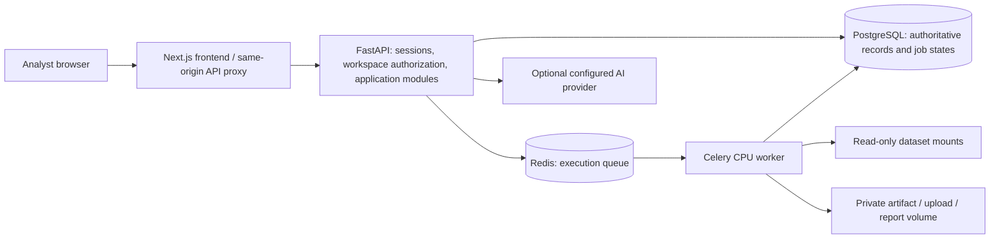

# Architecture

AEGIS is a local modular monolith with one authenticated workspace API. The browser never connects directly to Redis, PostgreSQL, raw dataset mounts, model files, or external AI providers.

## Service responsibilities

| Service | Responsibility | Persistent storage |
| --- | --- | --- |
| frontend | Next.js app, authenticated navigation, forms, visualization, same-origin API proxy | None; application records come from the API |
| api | Authentication, role checks, workspace-scoped queries, validation, deterministic analysis, provider adapters | PostgreSQL and private file volume |
| postgres | Users, sessions, workspace records, graph data, jobs, models, reports, approvals, audit | `postgres_data` volume |
| redis | Celery broker; not the system of record | `redis_data` volume |
| worker | Chunked ingestion, offline baseline training, reports, configured imports | Job status in PostgreSQL; artifacts in `artifacts` volume |
| training-worker | Optional additional CPU worker profile | Same authoritative database and private storage |

All host ports bind to `127.0.0.1`. PostgreSQL and Redis have no host ports. Containers run application processes as a non-root user. Raw dataset directories are mounted read-only. The default installation does not run discovery connectors or retrieve external threat feeds.

## Access boundaries

Owner, Admin, Analyst, and Viewer roles are checked by the backend on each workspace operation. An authenticated user cannot select another workspace merely by changing its identifier. Sessions use opaque random bearer values in HttpOnly cookies, with hashed session tokens in the database. State-changing authenticated requests require a CSRF token. Passwords use Argon2. Initial setup has no shared default password.

These mechanisms support a local product implementation. They do not establish an independent penetration test, production authentication assurance, formal tenant-isolation certification, or compliance.

## Data and computation

Application tables are migration-managed and use workspace foreign keys. The graph refers to the same asset identifiers as inventory, findings, simulations, recommendations, and review decisions. Simulation paths are calculations over the stored graph only. Recorded, inferred, and hypothetical edges retain their evidence classification.

Ingestion is separate from training. A dataset registry records source, citation, permission review, checksum, schema, and status. Training uses an explicit task, label, feature mapping, algorithm, and split configuration. Preprocessing is fitted on the training partition. Registered models remain inactive until an authorized user explicitly activates a version. Offline benchmark metrics are not live telemetry performance.

The AI assistant is a separate, optional provider. It uses backend-authorized, read-only record retrieval and stores conversations by user and workspace. It does not train a foundation model or apply defensive changes.

## Operations

`/api/health` reports process liveness; `/api/ready` checks service readiness. Docker Compose applies database migrations before API startup and starts the worker after API readiness. Job lifecycle records remain in PostgreSQL even when Redis is unavailable. Logs should contain action and job identifiers, concise errors, and service state rather than credentials or raw dataset rows.
